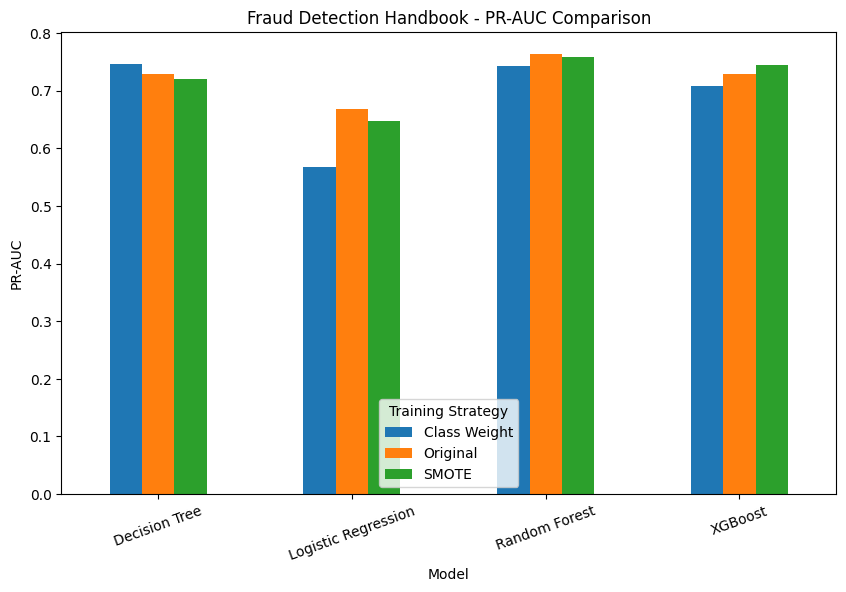
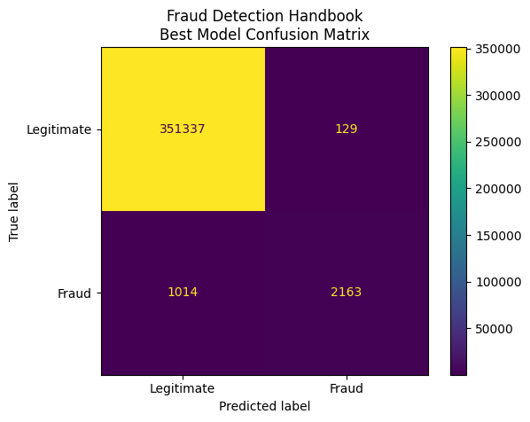
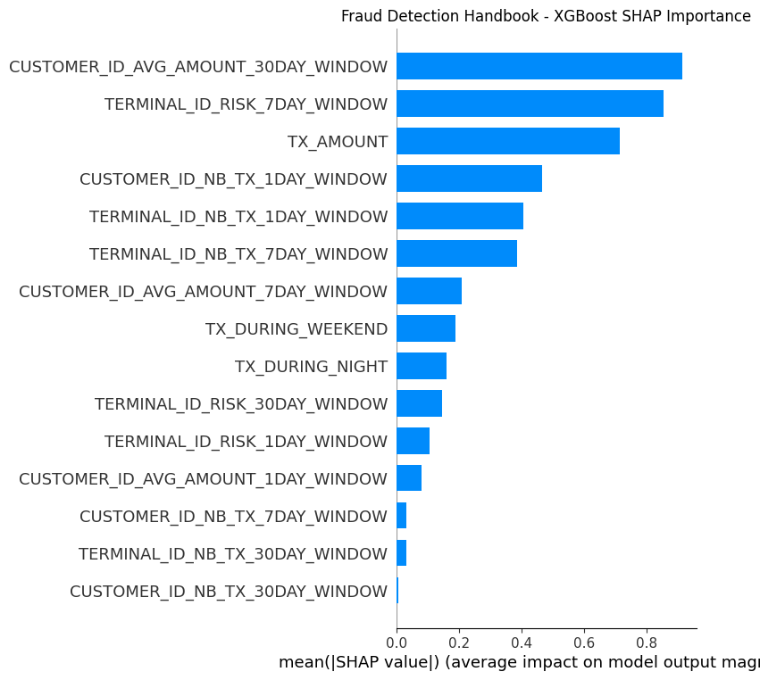

# Comparative and Explainable Machine Learning for Credit Card Fraud Detection under Severe Class Imbalance

My MSc dissertation. It compares a traditional rule-based fraud check with four machine learning models (Logistic Regression, Decision Tree, Random Forest and XGBoost) on two fraud datasets where fewer than 1% of transactions are fraud. It also tests whether class weighting or SMOTE oversampling helps, and uses feature importance and SHAP to explain the models.

MSc in Data Analytics, Technological University of the Shannon (TUS). Supervisor: Tom Davis. Completed in August 2026.

## Project at a glance

| | |
|---|---|
| **Datasets** | Fraud Detection Handbook simulated transactions (1,754,155 rows, 0.84% fraud) and ULB European credit card transactions (284,807 rows, 0.17% fraud) |
| **Models** | Rule-based baseline, Logistic Regression, Decision Tree, Random Forest, XGBoost |
| **Imbalance strategies** | Original data, class weighting, SMOTE |
| **Main metric** | PR-AUC, with precision, recall, F1, ROC-AUC, false-positive rate and MCC |
| **Explainability** | Logistic Regression coefficients, decision tree rules, feature importance, SHAP |
| **Tools** | Python (pandas, scikit-learn, imbalanced-learn, XGBoost, SHAP), Google Colab |
| **Completed** | August 2026 |

## Research questions

1. How much do machine learning models improve on a traditional rule-based approach?
2. How do Logistic Regression, Decision Tree, Random Forest and XGBoost compare on highly imbalanced fraud data?
3. Do class weighting and SMOTE improve results compared with keeping the original class distribution?
4. Which approach gives the best balance of fraud recall, precision, false-positive control and interpretability?

## Method

- **Feature engineering (Handbook data):** weekend and night-time flags, each customer's transaction count and average amount over 1, 7 and 30 days, and each terminal's transaction count and fraud risk over 1, 7 and 30 days. The terminal risk features use a delay period, so the models only see fraud labels that would have been known at the time.
- **Leakage checks:** IDs and the fraud scenario column were excluded from the features.
- **Splits:**
  - **Handbook data:** split by date, which is how fraud models are used in practice. Training covers April to July 2018, validation July to August, and testing August to September.
  - **ULB data:** a stratified 60/20/20 split.
- **Tuning:** hyperparameters were tuned on the validation set using PR-AUC. The probability threshold for each model was also chosen on validation data, then everything was scored once on the test set.

## Results

Best model on each dataset (test set):

| Dataset | Best model | PR-AUC | Precision | Recall | F1 | ROC-AUC | False-positive rate | MCC |
|---|---|---|---|---|---|---|---|---|
| Fraud Detection Handbook | Random Forest (original data) | 0.764 | 0.944 | 0.681 | 0.791 | 0.897 | 0.04% | 0.800 |
| ULB European | XGBoost (original data) | 0.876 | 0.893 | 0.847 | 0.869 | 0.974 | 0.02% | 0.869 |

PR-AUC for each algorithm, using its best imbalance strategy:

| Algorithm | Handbook | ULB |
|---|---|---|
| Rule-based baseline | 0.109 | not applicable |
| Logistic Regression | 0.668 | 0.743 |
| Decision Tree | 0.747 | 0.800 |
| Random Forest | **0.764** | 0.866 |
| XGBoost | 0.745 | **0.876** |

### Key findings

- **Machine learning clearly beats the rules.** On the Handbook data, the rule-based baseline reached a PR-AUC of only 0.109 and an F1 of 0.288. Random Forest reached 0.764 and 0.791.
- **Tree ensembles perform best.** Random Forest was best on the Handbook data and XGBoost on ULB, and both kept false positives below 0.05%.
- **Balancing the classes didn't reliably help.** For 6 of the 8 algorithm and dataset combinations, the original class distribution was best. SMOTE helped only XGBoost on the Handbook data, and class weighting helped only the Decision Tree there.
- **The engineered features mattered most.** Terminal fraud risk over 7 days, transaction amount and customers' 30-day spending were the strongest signals in the Handbook data, according to both feature importance and SHAP.

| Model comparison (Handbook) | Confusion matrix (Handbook, Random Forest) | SHAP values (Handbook, XGBoost) |
|---|---|---|
|  |  |  |

All 21 figures from the notebook are in [`images/`](images).

## Repository structure

```
notebooks/
  credit_card_fraud_detection.ipynb   Full analysis with outputs: loading, features, models, evaluation, SHAP
docs/
  MSc_Thesis_...docx / .pdf           Full dissertation
  Literature_Review_...docx           Literature review chapter (earlier draft)
  Comparative_Study_...docx           Comparative study paper (earlier draft)
images/                               Figures exported from the notebook
requirements.txt                      Python packages used
```

## How to run

1. **Download the data.** Neither dataset is stored in this repository because they are too large for GitHub.
   - **Fraud Detection Handbook:** [github.com/Fraud-Detection-Handbook/simulated-data-raw](https://github.com/Fraud-Detection-Handbook/simulated-data-raw). It contains 183 daily `.pkl` files in its `data` folder.
   - **ULB European credit card fraud:** [kaggle.com/datasets/mlg-ulb/creditcardfraud](https://www.kaggle.com/datasets/mlg-ulb/creditcardfraud), file `creditcard.csv`.
2. **Install the packages:** `pip install -r requirements.txt`
3. **Set the paths** in section 2 of the notebook (`PRIMARY_DATA_PATH` and `ULB_PATH`). The notebook was run in Google Colab with the data in Google Drive. To run it locally, remove the `drive.mount` cell.
4. **Point the notebook at the CSV.** The notebook loads the ULB data from an R data file (`creditcard.Rdata`). To use the Kaggle CSV instead, replace the `pyreadr.read_r(...)` lines in section 15 with:
   ```python
   ulb = pd.read_csv("creditcard.csv")
   ```
5. **Run all cells.** The full run, including feature engineering on 1.75 million rows and grid searches, takes some time.

## Data sources and licence

- **Fraud Detection Handbook data:** from Le Borgne, Siblini, Lebichot and Bontempi, *Reproducible Machine Learning for Credit Card Fraud Detection: Practical Handbook*.
- **ULB credit card fraud data:** from the Machine Learning Group at Université Libre de Bruxelles, via Kaggle.

My code and documents are released under the [MIT Licence](LICENSE).
